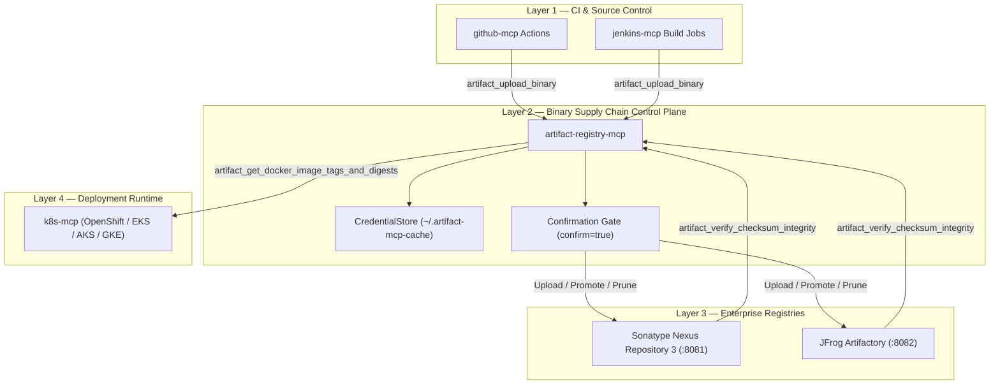
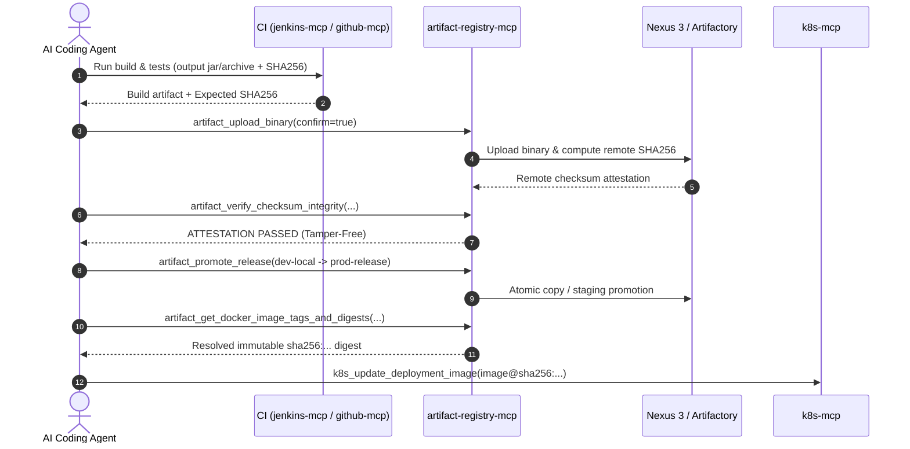

# Artifact Registry MCP Server

Open-source Model Context Protocol (MCP) server owned by **Pawan Gunjkar** (`pawangunjkar@gmail.com` · [GitHub](https://github.com/Pawangunjkar)). MIT licensed.

Production-grade MCP server supporting both **Sonatype Nexus Repository 3** and **JFrog Artifactory**. Bridges CI/CD build pipelines ([github-mcp](https://github.com/Pawangunjkar/github-mcp) and [jenkins-mcp](https://github.com/Pawangunjkar/jenkins-mcp)) and Kubernetes/OpenShift deployment automation ([k8s-mcp](https://github.com/Pawangunjkar/k8s-mcp)).

---

## Project Information

| Item | Value |
| --- | --- |
| Package | `artifact-registry-mcp` |
| CLI Entrypoint | `artifact-mcp`, `artifact-registry-mcp` |
| Runtime | Python 3.10+, FastMCP, stdio, httpx, pydantic |
| Supported Registries | Sonatype Nexus Repository 3, JFrog Artifactory |
| Supported Formats | `maven2`, `docker`/OCI, `npm`, `pypi`, `helm`, `raw`/`generic` |
| Security Model | Multi-session credential caching, Confirmation-gated mutations |
| Sibling MCPs | [github-mcp](https://github.com/Pawangunjkar/github-mcp), [jenkins-mcp](https://github.com/Pawangunjkar/jenkins-mcp), [k8s-mcp](https://github.com/Pawangunjkar/k8s-mcp), [observability-mcp](https://github.com/Pawangunjkar/observability-mcp) |

---

## Architecture & Supply Chain Flow





---

## 12 Core Tools Reference

### Connection & Session Management (5 Tools)
| Tool | Access | Description |
|------|--------|-------------|
| `artifact_connect` | Read-only | Connect to Sonatype Nexus 3 or JFrog Artifactory and create a named session |
| `artifact_status` | Read-only | Check connection health, version, authenticated user, and storage quota |
| `artifact_disconnect` | Read-only | Disconnect an active session and close HTTP connections |
| `artifact_list_sessions` | Read-only | List all active and cached registry sessions with masked credentials |
| `artifact_save_credentials` | Read-only | Save connection credentials to local cache file |

### Binary Discovery & Supply-Chain Attestation (4 Tools)
| Tool | Access | Description |
|------|--------|-------------|
| `artifact_list_repositories` | Read-only | List repositories filtered by format (`maven2`, `docker`, `npm`, `pypi`, `helm`, `raw`) and type |
| `artifact_search_binaries` | Read-only | Search components by name, group, version, or SHA256; returns URLs, timestamps, checksums |
| `artifact_get_docker_image_tags_and_digests` | Read-only | Resolves immutable `sha256:...` container digest for handoff to `k8s-mcp` |
| `artifact_verify_checksum_integrity` | Read-only | Compares expected SHA256 from CI against stored checksum before allowing deployment |

### Confirmation-Gated Mutating Tools (3 Tools)
| Tool | Access | Description |
|------|--------|-------------|
| `artifact_upload_binary` | **Confirm** (`confirm=true`) | Computes local SHA256, uploads file to registry, and verifies remote checksum match |
| `artifact_promote_release` | **Confirm** (`confirm=true`) | Promotes immutable artifact from staging to release repository without rebuilding |
| `artifact_cleanup_old_snapshots` | **Confirm** (`dry_run=false`, `confirm=true`) | Prunes stale snapshot builds beyond retention count (`dry_run=true` safe simulation) |

---

## Setup & Configuration

### Environment Variables
Configure the following environment variables (or let the agent prompt you via `artifact_connect`):

```bash
# Registry Type: "nexus" or "artifactory"
export ARTIFACT_REGISTRY_TYPE=nexus

# Registry Base URL
export ARTIFACT_REGISTRY_URL=http://localhost:8081

# Credentials
export ARTIFACT_REGISTRY_USER=admin
export ARTIFACT_REGISTRY_TOKEN=your-token-or-password
```

### Cursor Setup (`.cursor/mcp.json`)
```json
{
  "mcpServers": {
    "artifact-registry": {
      "command": "uvx",
      "args": ["artifact-registry-mcp"],
      "env": {
        "ARTIFACT_REGISTRY_TYPE": "${ARTIFACT_REGISTRY_TYPE}",
        "ARTIFACT_REGISTRY_URL": "${ARTIFACT_REGISTRY_URL}",
        "ARTIFACT_REGISTRY_USER": "${ARTIFACT_REGISTRY_USER}",
        "ARTIFACT_REGISTRY_TOKEN": "${ARTIFACT_REGISTRY_TOKEN}"
      }
    }
  }
}
```

### Claude Code Setup (`.mcp.json`)
```json
{
  "mcpServers": {
    "artifact-registry": {
      "command": "uvx",
      "args": ["artifact-registry-mcp"],
      "env": {
        "ARTIFACT_REGISTRY_TYPE": "${ARTIFACT_REGISTRY_TYPE}",
        "ARTIFACT_REGISTRY_URL": "${ARTIFACT_REGISTRY_URL}",
        "ARTIFACT_REGISTRY_USER": "${ARTIFACT_REGISTRY_USER}",
        "ARTIFACT_REGISTRY_TOKEN": "${ARTIFACT_REGISTRY_TOKEN}"
      }
    }
  }
}
```

---

## Testing & Quality Assurance

Run the test suite:

```bash
uv run -m unittest discover tests
```

Build the Agensi skill package:

```bash
uv run python scripts/build_agensi_zip.py
```

Build distribution packages (wheel and sdist):

```bash
uv build
```

---

## License

MIT License. Copyright (c) 2026 Pawan Gunjkar.

