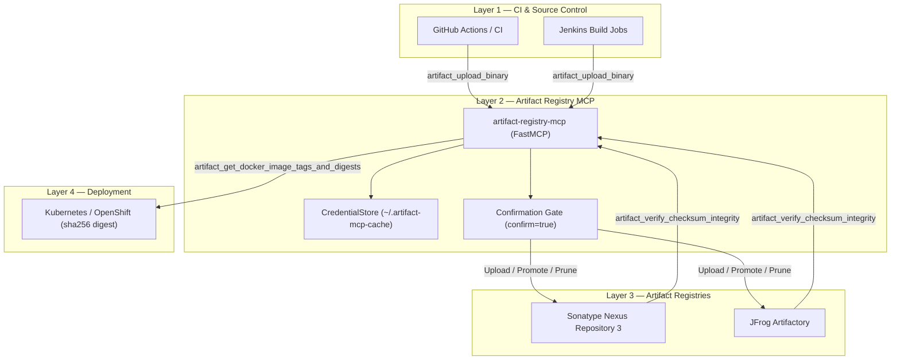

# Artifact Registry MCP Server

> A Python **Model Context Protocol (MCP)** server for **Sonatype Nexus Repository 3** and **JFrog Artifactory** — search binaries across Maven/Docker/npm/PyPI/Helm/raw repositories, resolve immutable OCI `sha256` digests, verify checksum integrity, and promote or prune releases with confirmation gates.

[](https://www.python.org/downloads/)
[](https://modelcontextprotocol.io/)
[](LICENSE)

---

## Overview

**Artifact Registry MCP Server** gives AI assistants direct read, attestation, and gated release-promotion control over **Sonatype Nexus 3** and **JFrog Artifactory**.

- **Dual registry support:** Unified tool surface across Nexus Repository 3 and JFrog Artifactory (`ARTIFACT_REGISTRY_TYPE=nexus` or `artifactory`).
- **Supply-chain attestation:** `artifact_verify_checksum_integrity` compares expected CI SHA-256 checksums against registry-stored checksums, and `artifact_get_docker_image_tags_and_digests` resolves immutable `sha256:...` digests before deployment.
- **Confirmation-gated mutations:** Uploads, release promotions, and snapshot cleanups (`dry_run=true` by default) require explicit `confirm=true` after preview.
- **Multi-session auth:** Supports named sessions and optional credential caching under `~/.artifact-mcp-cache`.

---

## Architecture & Supply-Chain Flow



---

## Project Layout

```text
artifact-registry-mcp/
├── src/artifact_mcp/
│   ├── __init__.py          # Package metadata
│   ├── __main__.py          # `python -m artifact_mcp` entry point
│   ├── server.py            # FastMCP server, 12 tools, /health, CLI transport
│   ├── artifact_client.py   # Nexus 3 & Artifactory REST clients + SHA-256 helpers
│   └── credential_store.py  # Session credential persistence
├── tests/                   # Unit + httpx.MockTransport regression tests
├── pyproject.toml           # Hatchling build config (`artifact-mcp`, `artifact-registry-mcp`)
├── Dockerfile               # Streamable HTTP container
└── mcpize.yaml              # Hosted HTTP runtime config
```

---

## Tools Reference (12)

### Connection & Session Management (5)

| Tool | Access | Description |
|---|---|---|
| `artifact_connect` | Read-only | Connect to Sonatype Nexus 3 or JFrog Artifactory and create a named session. |
| `artifact_status` | Read-only | Check connection health, version, authenticated user, and storage quota. |
| `artifact_disconnect` | Read-only | Disconnect an active session and close HTTP connections. |
| `artifact_list_sessions` | Read-only | List active and cached registry sessions with masked credentials. |
| `artifact_save_credentials` | Read-only | Save connection credentials to local cache file. |

### Binary Discovery & Supply-Chain Attestation (4)

| Tool | Access | Description |
|---|---|---|
| `artifact_list_repositories` | Read-only | List repositories filtered by format (`maven2`, `docker`, `npm`, `pypi`, `helm`, `raw`) and type. |
| `artifact_search_binaries` | Read-only | Search components by name, group, version, or SHA-256; returns URLs, timestamps, and checksums. |
| `artifact_get_docker_image_tags_and_digests` | Read-only | Resolve immutable `sha256:...` container digest for deployment. |
| `artifact_verify_checksum_integrity` | Read-only | Compare expected CI SHA-256 against the registry checksum before rollout. |

### Confirmation-Gated Mutating Tools (3)

| Tool | Access | Description |
|---|---|---|
| `artifact_upload_binary` | **Confirm** (`confirm=true`) | Compute local SHA-256, upload file, and verify remote checksum match. |
| `artifact_promote_release` | **Confirm** (`confirm=true`) | Promote immutable artifact from staging to release repository without rebuilding. |
| `artifact_cleanup_old_snapshots` | **Confirm** (`dry_run=false`, `confirm=true`) | Prune stale snapshot builds beyond retention count (`dry_run=true` simulates safely). |

---

## Installation & Configuration

Requires **Python 3.10+** and [uv](https://docs.astral.sh/uv/).

```bash
git clone https://github.com/Pawangunjkar/artifact-registry-mcp.git
cd artifact-registry-mcp
uv sync
uv run artifact-registry-mcp
```

### Environment Variables

| Variable | Default | Purpose |
|---|---|---|
| `ARTIFACT_REGISTRY_TYPE` | unset | `nexus` or `artifactory`. |
| `ARTIFACT_REGISTRY_URL` | unset | Base URL of your Nexus or Artifactory instance. |
| `ARTIFACT_REGISTRY_USER` | unset | Registry username or service account. |
| `ARTIFACT_REGISTRY_TOKEN` | unset | API token, password, or access token. |
| `ARTIFACT_REGISTRY_SSL_VERIFY` | `true` | Set to `false` for internal self-signed certificates. |
| `ARTIFACT_REGISTRY_TIMEOUT` | `30` | HTTP timeout in seconds. |
| `ARTIFACT_MCP_CACHE_DIR` | `~/.artifact-mcp-cache` | Session credential cache directory. |

### Cursor / Claude Code Setup

```json
{
  "mcpServers": {
    "artifact-registry": {
      "command": "uv",
      "args": ["run", "--directory", "/absolute/path/to/artifact-registry-mcp", "artifact-registry-mcp"],
      "env": {
        "ARTIFACT_REGISTRY_TYPE": "nexus",
        "ARTIFACT_REGISTRY_URL": "http://localhost:8081",
        "ARTIFACT_REGISTRY_USER": "admin",
        "ARTIFACT_REGISTRY_TOKEN": "your-token-or-password"
      }
    }
  }
}
```

---

## Development & Tests

```bash
uv run python -m unittest discover -s tests -v
uv build
```

---

## Author & License

**Pawan Gunjkar** — pawangunjkar@gmail.com · [GitHub](https://github.com/Pawangunjkar)

MIT License — see [LICENSE](LICENSE).
